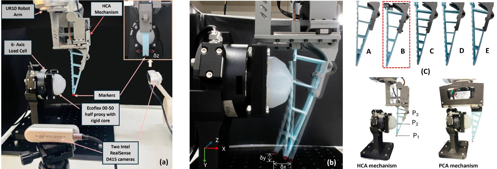
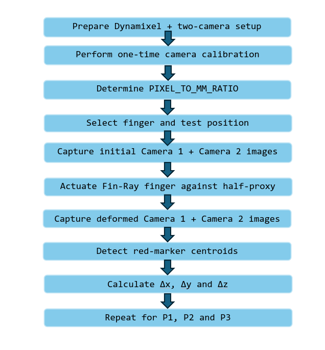

# Experimental Validation Setup for Optimal Design Testing

An experimental and image-processing framework for validating the **deformation behaviour of optimized Fin-Ray finger designs** under controlled contact conditions.

The validation framework integrates:

- Dynamixel-based finger actuation
- An Ecoflex 00-50 deformable half-proxy with a rigid core
- Two approximately orthogonal camera views
- Red-marker-based fingertip tracking
- Pixel-to-millimetre camera calibration
- Three-dimensional fingertip displacement measurement

The overall experimental setup and validation procedure are illustrated below.

<p align="center">
  
</p>

---

## Experimental Displacement Measurement

Three-dimensional fingertip displacement is quantified using a calibrated multi-view marker-tracking approach. A red marker attached to the fingertip is tracked between the initial and deformed configurations using two approximately orthogonal camera views.

The imaging system is calibrated using a known 13-mm displacement to determine the pixel-to-millimetre conversion factor. For marker localization, each image is converted from BGR to HSV colour space, and the red marker is isolated using dual-range HSV thresholding to account for the hue wrap-around of red. The resulting binary masks are combined, followed by contour extraction and largest-contour selection to identify the marker region. Spatial image moments are then used to estimate the marker centroid.

Differences between the initial and final centroid coordinates provide the pixel-level marker displacement, which is converted to physical displacement using the calibrated scale. Horizontal and vertical displacements from the first camera view provide two in-plane displacement components, while horizontal displacement from the approximately orthogonal second view captures the remaining out-of-plane component. These measurements are subsequently mapped to the corresponding $\Delta x$, $\Delta y$, and $\Delta z$ COMSOL coordinate directions according to the known camera orientations, enabling direct experimental validation of the simulated fingertip deformation.

---

# Experimental Procedure

## 1. Prepare the Experimental Workspace

Place the following components in the same working location:

```text
dynamixel_motor
DynamixelSDK
camera.py
```

The `dynamixel_motor` package controls the Dynamixel actuator through ROS 2, while `camera.py` simultaneously accesses the two approximately orthogonal cameras and captures the image pairs required for fingertip displacement measurement.

---

## 2. Start the Two-Camera Image Acquisition

Run:

```bash
python3 camera.py
```

The program opens both camera views simultaneously.

Before actuating the Fin-Ray finger, press:

```text
1
```

to capture the **initial configuration** from both cameras.

This generates the initial images corresponding to the two approximately orthogonal views.

Keep the camera program running while proceeding with the Dynamixel actuation.

---

## 3. Start the Dynamixel Motor Node

Open a separate terminal and run:

```bash
ros2 run dynamixel_motor dynamixel_position_node
```

This starts the Dynamixel motor-control subscriber node and waits for a command to be published to the motor-control topic.

Keep this terminal running throughout the experiment.

---

## 4. Actuate the Fin-Ray Finger

Open another terminal and publish the forward command:

```bash
ros2 topic pub --once /motor_control std_msgs/msg/String "{data: forward}"
```

The Dynamixel actuator drives the gripper forward, causing the Fin-Ray finger to contact and deform against the **Ecoflex 00-50 half-proxy with rigid core**.

---

## 5. Capture the Deformed Configuration

After the finger has contacted and deformed against the half-proxy, return to the camera window.

Press:

```text
2
```

to capture the **post-contact/deformed configuration** from both cameras.

Then press:

```text
q
```

to exit the camera program.

The image-acquisition stage generates four images:

```text
camera1_image1.png    # Camera 1 - initial configuration
camera1_image2.png    # Camera 1 - deformed configuration

camera2_image1.png    # Camera 2 - initial configuration
camera2_image2.png    # Camera 2 - deformed configuration
```

These images are subsequently used for marker detection and three-dimensional fingertip displacement calculation.

---

# Image Processing and Displacement Calculation

Image processing is performed in a separate **Google Colab** environment using the three Python scripts provided:

```text
Cell 1 → pixel_to_mm_ratio_calculation.py
Cell 2 → red_marker_identification.py
Cell 3 → tip_displacement_calculation.py
```

Cell 1 performs a **one-time camera calibration**, while Cells 2 and 3 are repeated for each experimental test position.

---

## 6. Pixel-to-Millimetre Calibration

Copy the contents of [`pixel_to_mm_ratio_calculation.py`](pixel_to_mm_ratio_calculation.py) into **Cell 1** of the Google Colab notebook.

Before executing the code, obtain a calibration image pair.

Using the Dynamixel motor-control setup, move the fingertip through a **known displacement along the x-axis**, from calibration position A to position B.

The known displacement used for calibration is:

```text
13.0 mm
```

Use `camera.py` to capture the fingertip at positions A and B and provide the two calibration images to the Colab environment as:

```text
pose1.png
pose2.png
```

Then execute:

```python
# Cell 1
# Use the contents of:
# pixel_to_mm_ratio_calculation.py
```

The code detects the red fingertip marker in both calibration images and calculates its horizontal pixel displacement.

The pixel-to-millimetre conversion factor is calculated as:

**PIXEL_TO_MM_RATIO = Known displacement (mm) / Measured displacement (pixels)**

The resulting value is expressed in:

```text
mm/pixel
```

and is subsequently used to convert image-space marker displacement into physical fingertip displacement.

> **Important:** `pixel_to_mm_ratio_calculation.py` only needs to be executed **once** for the calibrated camera setup. The resulting `PIXEL_TO_MM_RATIO` should then be used for all subsequent displacement calculations.

---

## 7. Red-Marker Identification

Copy the contents of [`red_marker_identification.py`](red_marker_identification.py) into **Cell 2**.

Upload the four images obtained during the experimental test:

```text
camera1_image1.png
camera1_image2.png
camera2_image1.png
camera2_image2.png
```

Then execute:

```python
# Cell 2
# Use the contents of:
# red_marker_identification.py
```

The code identifies the red fingertip marker in each image using the following procedure:

- Load each captured image
- Convert the image from BGR to HSV colour space
- Apply two HSV threshold ranges for red
- Combine the two red binary masks
- Extract contours from the resulting mask
- Select the largest detected red contour
- Calculate spatial image moments
- Estimate the centroid of the red marker
- Store the marker coordinates for subsequent displacement calculation

Two HSV ranges are used because red wraps around the beginning and end of the OpenCV HSV hue range.

The detected marker position is displayed on each image, allowing marker localization to be visually verified before proceeding with displacement calculation.

---

## 8. Three-Dimensional Fingertip Displacement Calculation

Copy the contents of [`tip_displacement_calculation.py`](tip_displacement_calculation.py) into **Cell 3**.

Before executing the code, update:

```python
PIXEL_TO_MM_RATIO = 0.25
```

with the calibrated value obtained from **Cell 1**.

Then execute:

```python
# Cell 3
# Use the contents of:
# tip_displacement_calculation.py
```

The script uses the marker centroids identified in Cell 2 to calculate fingertip displacement between the initial and deformed configurations.

### Camera 1

The horizontal marker displacement between:

```text
camera1_image1.png
```

and:

```text
camera1_image2.png
```

is used to determine:

$$\Delta x$$

The vertical marker displacement from the same image pair is used to determine:

$$\Delta y$$

### Camera 2

The horizontal marker displacement between:

```text
camera2_image1.png
```

and:

```text
camera2_image2.png
```

is used to determine the remaining approximately orthogonal displacement component:

$$\Delta z$$

Pixel displacements are converted to millimetres using:

**Δd (mm) = Δd (pixels) × PIXEL_TO_MM_RATIO**

The measurements are therefore mapped as:

```text
Camera 1 horizontal displacement → Δx
Camera 1 vertical displacement   → Δy
Camera 2 horizontal displacement → Δz
```

according to the known camera orientations relative to the COMSOL coordinate system.

The final output provides the experimentally measured:

```text
Δx (mm)
Δy (mm)
Δz (mm)
```

for the tested Fin-Ray finger configuration.

---

# Repeating the Measurement Across Test Positions

The experimental displacement measurement is performed at **P1, P2, and P3** for every Fin-Ray finger design evaluated, following the test arrangement shown in `Experimental_setup_for_validation.jpeg`.

Camera calibration using:

```text
pixel_to_mm_ratio_calculation.py
```

is required only once for the calibrated camera configuration.

For each finger design and test position:

```text
P1
P2
P3
```

repeat the following procedure:

1. Position the experimental setup at the required test position.
2. Run `camera.py`.
3. Press `1` to capture the two initial images.
4. Start the Dynamixel motor node if it is not already running.
5. Publish the forward motor command.
6. Allow the Fin-Ray finger to contact and deform against the Ecoflex 00-50 half-proxy.
7. Return to the camera window and press `2` to capture the two deformed-state images.
8. Press `q` to exit the camera program.
9. Upload the four captured images to Google Colab.
10. Run `red_marker_identification.py`.
11. Run `tip_displacement_calculation.py`.
12. Record the resulting $\Delta x$, $\Delta y$, and $\Delta z$ fingertip displacements.

Therefore, **Cells 2 and 3 are repeated for P1, P2, and P3 for every finger design**, while Cell 1 is required only for the initial camera calibration.

---

# Workflow Summary

<p align="center">
  
</p>

The experimentally measured three-dimensional fingertip displacements can subsequently be compared with the corresponding simulated responses to validate the optimized Fin-Ray finger designs.
